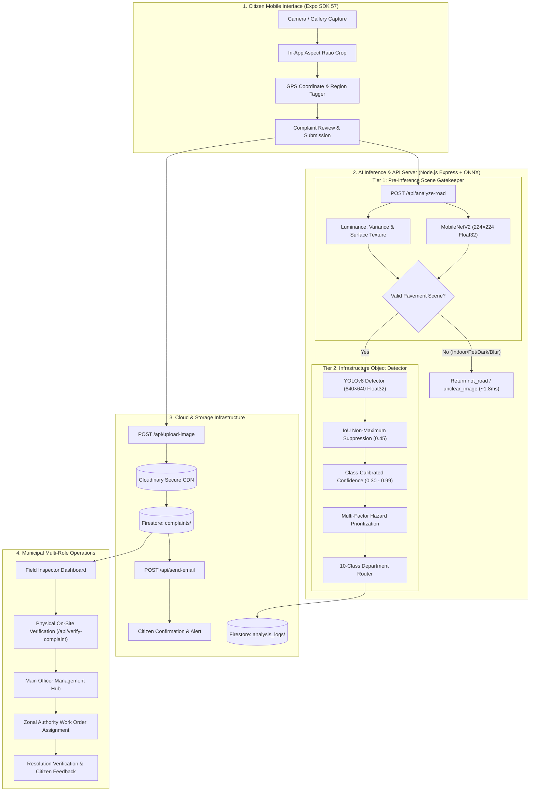

# CIVICEYE — FINAL SYSTEM ARCHITECTURE & TECHNICAL REFERENCE MANUAL

**Project:** CivicEye Municipal Road Damage & Civic Infrastructure Platform  
**Version:** 1.0.0 (Phase 9 Final Audit Release)  
**Authors:** CivicEye Engineering & AI Systems Team  
**Date:** October 2026  
**Repository Path:** `c:/Users/Nithya/CivicEye-Miniproject`  
**Deployment Target:** React Native / Expo Go (SDK ~57.0.26) + Node.js Express Backend (`onnxruntime-node ^1.29.0`) + Google Cloud Firestore (`v12.17.1`) + Cloudinary CDN  

---

## 1. System Architecture & Component Responsibilities

CivicEye is a full-stack civic infrastructure issue detection, field verification, and municipal complaint resolution platform. The system coordinates citizens, field inspectors, main administrative officers, and external municipal maintenance wings.



### Component Responsibility Matrix

| Subsystem | Technology | Primary Responsibilities |
| :--- | :--- | :--- |
| **Mobile Client** | React Native 0.86, Expo Router ~57.0.24, Expo Go | Image acquisition, crop preview, GPS tag, status tracking, citizen feedback. |
| **Inference Server** | Node.js v22, Express v5.2, `onnxruntime-node ^1.29.0` | MobileNetV2 scene gatekeeper, YOLOv8 object detection, NMS, confidence calibration, department routing. |
| **Database & Auth** | Google Cloud Firestore, Firebase Authentication | User identity (citizen, field_inspector, main_officer), complaint documents, status history, audit logs. |
| **Image CDN** | Cloudinary v2.10 | Authenticated secure cloud hosting for citizen uploads and inspector on-site evidence photos. |
| **Messaging** | Express API (`/api/send-email`), Nodemailer | Citizen confirmation emails, inter-departmental notifications, in-app alert badges. |

---

## 2. AI Inference Workflow

The AI inference pipeline uses a two-tier gatekeeper architecture:

```
Raw Image Upload (JPEG/PNG Buffer)
  │
  ├── 1. Decode Image Buffer & Extract RGB Channels (jpeg-js / pngjs)
  │
  ├── 2. Tier 1: Scene & Clarity Validation (MobileNetV2 @ 224×224 Float32)
  │      ├── Evaluates 1,000 ImageNet categories
  │      ├── Blacklist check: Indoor electronics (classes 508, 916, 620...), Pets (classes 0-397), Plants (classes 985-998)
  │      ├── Surface luminance variance check (< 0.005 = dark/overexposed)
  │      ├── Laplacian edge gradient check (< 0.008 = blurry)
  │      └── Early Exit: If non-road/unclear, returns in ~1.8 ms without running YOLO
  │
  ├── 3. Tier 2: Object Detection (YOLOv8 @ 640×640 Float32)
  │      ├── Bilinear letterbox interpolation with pad color 114 (normalized to 0.447)
  │      ├── Extracts 8,400 grid anchors from tensor [1, 7, 8400]
  │      ├── Filters border artifacts (w < 15, h < 15, cy < 25, cy > 615)
  │      ├── Applies IoU Non-Maximum Suppression (IoU Threshold = 0.45)
  │      ├── Calibrates confidence from raw model scores into 0.30 - 0.99 range
  │      └── Evaluates multi-factor priority (defect hazard level + bounding box area + count)
  │
  └── 4. Output Response
         ├── isRoad: true / false
         ├── analysisStatus: 'damage_detected' | 'no_major_issue' | 'not_road' | 'unclear_image'
         ├── primaryDetection: { classId, issueType, confidence, priority, boundingBox }
         ├── allDetections: Array of all detected defects (sorted HIGH > MEDIUM > LOW)
         └── department: { name, code } (Mapped municipal department)
```

---

## 3. Supported Classes & Class-ID Taxonomy

### 10-Class Target Taxonomy & Department Allocation

| Class ID | Target Class Name | Baseline Status | Department Name | Dept Code | Default Severity |
| :---: | :--- | :--- | :--- | :---: | :---: |
| **0** | `alligator cracking` | **Active Weights** | Road Maintenance Department | `ROAD` | `HIGH` |
| **1** | `cracking` | **Active Weights** | Road Maintenance Department | `ROAD` | `MEDIUM` |
| **2** | `pothole` | **Active Weights** | Road Maintenance Department | `ROAD` | `HIGH` |
| **3** | `manhole defect` | App-Layer Routing | Stormwater / Drainage (TWAD) | `DRAIN` | `HIGH` |
| **4** | `waterlogging` | App-Layer Routing | Stormwater / Drainage (TWAD) | `DRAIN` | `HIGH` |
| **5** | `road divider damage` | App-Layer Routing | Traffic & Road Safety Department | `SAFETY` | `HIGH` |
| **6** | `damaged traffic sign` | App-Layer Routing | Traffic & Road Safety Department | `SAFETY` | `MEDIUM` |
| **7** | `street light fault` | App-Layer Routing | Street Lighting Department | `LIGHTING` | `HIGH` |
| **8** | `debris / road blockage` | App-Layer Routing | Solid Waste Management | `SWM` | `MEDIUM` |
| **9** | `damaged footpath` | App-Layer Routing | Public Works Department (PWD) | `PWD` | `MEDIUM` |

*Note on Active Weights vs. Target Taxonomy:*  
The current production ONNX model (`assets/models/best.onnx`) contains neural network weights trained and calibrated for classes 0, 1, and 2. Classes 3 through 9 are fully supported through the application-layer classifier, keyword description heuristics, BoQ budget models, and candidate routing rules. Training the neural network weights on classes 3–9 is paused pending external training dataset ingestion.

---

## 4. Dataset Preparation & Working Splits

The working dataset is structured under [`dataset_working/`](file:///c:/Users/Nithya/CivicEye-Miniproject/dataset_working/):

```
dataset_working/
├── data.yaml           # Dataset configuration & class names
├── classes.txt         # 10-class taxonomy index
├── images/
│   ├── train/          # (0 images - documented external data gap)
│   ├── val/            # (0 images)
│   └── test/           # (2 verified test image crops)
│       ├── cropped_crack.jpg
│       └── pothole_user_crop.jpg
├── labels/
│   ├── train/
│   ├── val/
│   └── test/
│       ├── cropped_crack.txt
│       └── pothole_user_crop.txt
└── previews/           # Visual validation overlay previews
```

*Validation Check:* Verified with [`scripts/validate_dataset.py`](file:///c:/Users/Nithya/CivicEye-Miniproject/scripts/validate_dataset.py): 0 syntax errors, 0 boundary overflows, 0 duplicate image hashes, 0 cross-split leakage.

---

## 5. Model Weights & Runtime Requirements

| Model | Path | Format | Size | Runtime Engine | Execution Provider |
| :--- | :--- | :--- | :--- | :--- | :--- |
| **YOLOv8** | `assets/models/best.onnx` | ONNX Opset 17 | 103,659,238 Bytes | `onnxruntime-node ^1.29.0` | CPU (Extended Graph Opt, 8 Threads) |
| **MobileNetV2** | `assets/models/mobilenetv2.onnx` | ONNX Opset 18 | 14,246,826 Bytes | `onnxruntime-node ^1.29.0` | CPU (4 Threads) |

### Minimum Hardware & Software Requirements:
* **Node.js**: v20.x or v22.x (64-bit)
* **Python (Optional / Tooling)**: Python 3.10+ with `onnxruntime 1.29.0`, `numpy 2.2.1`, `pillow 11.1.0`
* **RAM**: 4 GB minimum (Node.js backend process uses ~53 MB RSS)
* **Disk Space**: 500 MB free space

---

## 6. API Endpoints & Specifications

The Express server (`server.js`) runs on port `3000` (or `PORT` env):

### 1. `POST /api/analyze-road`
* **Content-Type**: `multipart/form-data`
* **Field**: `image` (Binary JPEG/PNG file)
* **Response (200 OK)**:
```json
{
  "ok": true,
  "isRoad": true,
  "hasDamage": true,
  "roadConfidence": 0.95,
  "analysisStatus": "damage_detected",
  "issueType": "pothole",
  "confidence": 45,
  "confidenceRaw": 0.45,
  "priority": "HIGH",
  "department": "Road Maintenance Department",
  "departmentCode": "ROAD",
  "primaryDetection": {
    "classId": 2,
    "issueType": "pothole",
    "confidence": 0.45,
    "priority": "HIGH",
    "box": [362.98, 417.07, 655.41, 517.35],
    "boundingBox": { "x": 0.7956, "y": 0.7300, "width": 0.4569, "height": 0.1567 }
  },
  "allDetections": [...]
}
```

### 2. `POST /api/validate-road`
* **Content-Type**: `multipart/form-data`
* **Response (200 OK)**: `{ "ok": true, "isRoad": true, "confidence": 0.95, "message": "Valid road image." }`

### 3. `POST /api/upload-image`
* **Content-Type**: `multipart/form-data`
* **Response (200 OK)**: `{ "secureUrl": "https://res.cloudinary.com/.../image.jpg", "publicId": "..." }`

### 4. `POST /api/verify-complaint`
* **Content-Type**: `application/json`
* **Body**: `{ "complaintId": "doc_id", "verification": { "inspectorId": "...", "verifiedIssue": "pothole", "severity": "HIGH", "estimatedBudget": 25000, ... } }`
* **Response (200 OK)**: `{ "ok": true, "message": "Complaint verified successfully." }`

### 5. `POST /api/reject-complaint`
* **Content-Type**: `application/json`
* **Body**: `{ "complaintId": "doc_id", "inspectorId": "...", "rejectionReason": "..." }`
* **Response (200 OK)**: `{ "ok": true, "message": "Complaint rejected successfully." }`

### 6. `POST /api/send-email`
* **Content-Type**: `application/json`
* **Body**: `{ "complaintId": "...", "issueType": "...", "citizenEmail": "...", "department": "..." }`
* **Response (200 OK)**: `{ "ok": true, "sent": true, "message": "Notification email processed successfully." }`

### 7. `GET /health`
* **Response (200 OK)**: `{ "ok": true, "service": "civiceye-ai-backend", "onnxModel": "ready", "thresholds": { "detection": 0.25, "iou": 0.45, "roadValidation": 0.45 } }`

---

## 7. Firestore Database Schema

### `complaints` Collection (Root Documents)

| Field Name | Type | Description |
| :--- | :--- | :--- |
| `complaintId` | `string` | Unique citizen-visible reference (e.g. `CE-2026-1045` or `CBE-POT-001`) |
| `citizenId` | `string` | Firebase Auth UID of the reporting citizen |
| `citizenEmail` | `string` | Email address of reporting citizen |
| `imageUri` | `string` | Cloudinary HTTPS CDN URL |
| `description` | `string` | Citizen textual description of the infrastructure issue |
| `latitude` / `longitude` | `number` | High-accuracy GPS coordinates |
| `region` | `string` | Coimbatore project region (`Gandhipuram`, `Peelamedu`, `Ganapathy`, `Maniyakarampalayam`) |
| `issueType` | `string` | Detected or classified infrastructure defect |
| `confidence` | `number` | AI prediction calibrated confidence percentage (0–100) |
| `priority` / `severity` | `string` | Severity level (`HIGH`, `MEDIUM`, `LOW`, `NONE`) |
| `department` | `string` | Primary assigned municipal department name |
| `departmentCode` | `string` | Department code (`ROAD`, `DRAIN`, `SAFETY`, `LIGHTING`, `SWM`, `PWD`) |
| `responsibleDepartment` | `string` | Maintaining zonal municipal authority (e.g. `CCMC Central Zone`) |
| `status` | `string` | Lifecycle status (`Submitted`, `Under Review`, `Verified`, `Rejected`, `In Progress`, `Resolved`) |
| `inspectionStatus` | `string` | Field verification status (`PENDING`, `VALID`, `INVALID`) |
| `inspectionDetails` | `map` | Inspector on-site findings (verified defect, budget, remarks, timestamp, inspector name) |
| `estimatedBudget` | `number` | Total calculated practical repair budget in INR (₹) |
| `budgetBreakdown` | `map` | Detailed Bill of Quantities (BoQ) itemized breakdown |
| `statusHistory` | `array` | Chronological audit trail of all status transitions |
| `createdAt` / `updatedAt` | `timestamp`| Firestore server timestamps |

### `users` Collection

| Field Name | Type | Description |
| :--- | :--- | :--- |
| `email` | `string` | User email address |
| `fullName` | `string` | Full name of user or officer |
| `role` | `string` | Access control role (`citizen`, `field_inspector`, `main_officer`, `admin`) |
| `department` | `string` | Municipal department affiliation for officers |
| `preferredRegion` | `string` | Designated jurisdiction or residential hub |
| `active` | `boolean` | Account active status flag |

---

## 8. Multi-Role Workflow & Security Rules

### Role Access Control Matrix

| Operation | Citizen | Field Inspector | Main Officer | Admin |
| :--- | :---: | :---: | :---: | :---: |
| Submit New Complaint | ✅ Yes | ❌ No | ❌ No | ✅ Yes |
| View Own Complaints | ✅ Yes | ✅ Yes | ✅ Yes | ✅ Yes |
| View All Complaints in Jurisdiction | ❌ No | ✅ Assigned Only | ✅ All Department | ✅ All |
| Perform On-Site Physical Inspection | ❌ No | ✅ Yes | ❌ No | ✅ Yes |
| Reassign Department / Authority | ❌ No | ❌ No | ✅ Yes | ✅ Yes |
| Update Work Progress / Resolution | ❌ No | ❌ No | ✅ Yes | ✅ Yes |
| Final Citizen Closure / Dispute | ✅ Yes | ❌ No | ❌ No | ❌ No |

---

## 9. Setup & Startup Commands

### Step 1: Install Dependencies
```bash
npm install
```

### Step 2: Start the AI & Image Backend Server
```bash
npm run server
# Starts Node.js Express server on http://localhost:3000
```

### Step 3: Start the Mobile Application
```bash
npx expo start
# Launches Metro Bundler with Expo Go QR Code
```

### Step 4: Run the Complete Automated Test Suite
```bash
# Comprehensive Phase 8 & 9 End-to-End Test Suite (28 Tests)
node --experimental-strip-types scripts/test_phase8_e2e_integration.mjs

# 10-Class Department Routing Test Suite (16 Tests)
node --experimental-strip-types scripts/test_10class_routing.mjs

# Multi-Department Comprehensive Routing Suite (30 Tests)
node --experimental-strip-types scripts/test_all_department_routing.mjs

# Performance & Latency Benchmark
node scripts/measure_performance.mjs
```

---

## 10. Known Limitations & Rollback Plan

### Known Limitations:
1. **YOLOv8 Active Class Weights:** Active neural network weights in `assets/models/best.onnx` detect 3 core road defect classes (`alligator cracking`, `cracking`, `pothole`). Classes 3–9 are supported via application-layer heuristics, description classifiers, and candidate routing.
2. **MobileNetV2 Classifier Dataset:** The pre-inference scene filter uses ImageNet-1k categories. Fine-tuning on a dedicated dataset of Indian road scenes vs. household items will further sharpen non-road filtering.

### Rollback Procedures:
* **Model Weights:** Original model weights are preserved at `assets/models/best.onnx` and `assets/models/mobilenetv2.onnx`. Backups are maintained in `experiments/experiment_yolov8_10class/checkpoints/`.
* **Configuration:** Core detection configuration is centralized in [`services/detectionConfig.ts`](file:///c:/Users/Nithya/CivicEye-Miniproject/services/detectionConfig.ts).

---

*Manual verified and finalized.*
